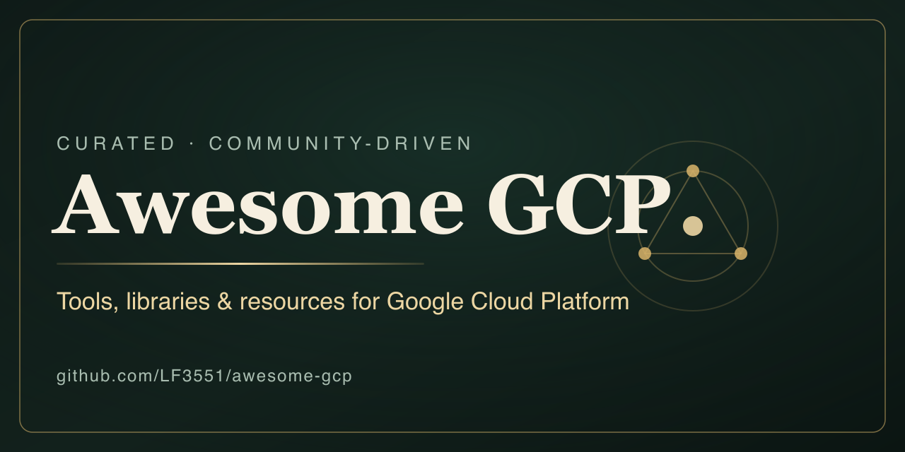

# Awesome GCP 

> A curated list of tools, libraries, and resources for [Google Cloud](https://cloud.google.com).

Google Cloud is the suite of cloud services that runs on the same infrastructure Google uses internally. This list collects official tooling, open-source projects, and learning material for building, securing, and operating workloads on it, from the first `gcloud` command to a production landing zone.

The official [GoogleCloudPlatform/awesome-google-cloud](https://github.com/GoogleCloudPlatform/awesome-google-cloud) list has been archived since 2024. This list continues it with three rules: every link is checked automatically every week, descriptions stay short and factual, and contributions that pass the automated check are merged within minutes. Missing something? See [Contributing](#contributing).

## Contents

- [Official Tools & SDKs](#official-tools--sdks)
- [Infrastructure as Code](#infrastructure-as-code)
- [Serverless](#serverless)
- [Kubernetes & GKE](#kubernetes--gke)
- [Networking](#networking)
- [Databases & Storage](#databases--storage)
- [Data & AI](#data--ai)
- [Security & IAM](#security--iam)
- [Observability](#observability)
- [CI/CD & DevOps](#cicd--devops)
- [Local Development & Testing](#local-development--testing)
- [Cost & FinOps](#cost--finops)
- [Architecture & Decision Tools](#architecture--decision-tools)
- [Samples & Templates](#samples--templates)
- [Learning & Certification](#learning--certification)
- [Community & Reference](#community--reference)
- [Curated Lists](#curated-lists)
- [Blogs & Newsletters](#blogs--newsletters)

## Official Tools & SDKs

- [Google Cloud CLI (gcloud)](https://cloud.google.com/sdk/gcloud) - Command-line tool for creating and managing Google Cloud resources.
- [Google Cloud SDK](https://cloud.google.com/sdk) - Downloadable toolkit bundling gcloud, gsutil, and bq for interacting with Google Cloud.
- [Cloud Code](https://cloud.google.com/code) - IDE extensions for VS Code and IntelliJ to write, debug, and deploy cloud-native apps.
- [Cloud Code for VS Code](https://cloud.google.com/code/docs/vscode) - VS Code extension for developing Kubernetes and Cloud Run applications on Google Cloud.
- [Cloud Code for IntelliJ](https://cloud.google.com/code/docs/intellij) - IntelliJ plugin for building and deploying cloud-native applications to Google Cloud.
- [Cloud Shell](https://cloud.google.com/shell) - Browser-based shell environment preloaded with the gcloud CLI and common tools.
- [Google Cloud Console](https://console.cloud.google.com) - Web-based interface for managing Google Cloud projects and resources.
- [gcloud alpha/beta reference](https://cloud.google.com/sdk/gcloud/reference/alpha) - Reference for pre-GA gcloud command groups covering early-access features.
- [APIs Explorer](https://developers.google.com/apis-explorer) - Browser tool for calling Google Cloud REST APIs without writing code.
- [Cloud Client Libraries for Python](https://github.com/googleapis/google-cloud-python) - Idiomatic Python clients for Google Cloud APIs.
- [Cloud Client Libraries for Go](https://github.com/googleapis/google-cloud-go) - Idiomatic Go clients for Google Cloud APIs.
- [Cloud Client Libraries for Node.js](https://github.com/googleapis/google-cloud-node) - Idiomatic Node.js clients for Google Cloud APIs.
- [Cloud Client Libraries for Java](https://github.com/googleapis/google-cloud-java) - Idiomatic Java clients for Google Cloud APIs.
- [Go Cloud Development Kit](https://github.com/google/go-cloud) - Portable Go APIs for blob storage, pub/sub, secrets, and databases across Google Cloud and other providers.

## Infrastructure as Code

- [Terraform Google Provider](https://registry.terraform.io/providers/hashicorp/google/latest/docs) - Official Terraform provider for provisioning Google Cloud resources.
- [Cloud Foundation Toolkit](https://cloud.google.com/docs/terraform/blueprints/terraform-blueprints) - Collection of reference Terraform modules and blueprints for Google Cloud.
- [Cloud Foundation Toolkit (GitHub)](https://github.com/GoogleCloudPlatform/cloud-foundation-toolkit) - Source repository for the Cloud Foundation Toolkit CLI and templates.
- [Config Connector](https://cloud.google.com/config-connector/docs/overview) - Kubernetes addon that manages Google Cloud resources through Kubernetes manifests.
- [Pulumi Google Cloud Provider](https://www.pulumi.com/registry/packages/gcp/) - Infrastructure-as-code provider for managing Google Cloud using general-purpose languages.
- [Crossplane GCP Provider](https://github.com/crossplane-contrib/provider-upjet-gcp) - Crossplane provider for provisioning Google Cloud resources via Kubernetes APIs.
- [Deployment Manager](https://cloud.google.com/deployment-manager/docs) - Google's native templated deployment service (deprecated; prefer Terraform or Config Connector).
- [Cloud Foundation Fabric](https://github.com/GoogleCloudPlatform/cloud-foundation-fabric) - Terraform modules and end-to-end blueprints for landing zones, networking, and data platforms, maintained by Google engineers.
- [Terraform Google Modules](https://github.com/terraform-google-modules) - GitHub organization hosting Google-maintained Terraform modules for GKE, VPC, IAM, projects, and more.
- [Terraform Example Foundation](https://github.com/terraform-google-modules/terraform-example-foundation) - Reference Terraform implementation of the Google Cloud enterprise foundations blueprint.
- [Infrastructure Manager](https://cloud.google.com/infrastructure-manager/docs) - Managed service that runs Terraform deployments on Google Cloud.
- [Bulk export to Terraform](https://cloud.google.com/docs/terraform/resource-management/export) - Guide for exporting existing Google Cloud resources to Terraform configuration with gcloud.
- [Magic Modules](https://github.com/GoogleCloudPlatform/magic-modules) - Code generator behind the Terraform Google provider, where provider changes are contributed.

## Serverless

- [Cloud Run](https://cloud.google.com/run/docs) - Managed platform for running containers that scale to zero, with services, jobs, and worker pools.
- [Cloud Run functions](https://cloud.google.com/functions/docs) - Event-driven functions service, formerly Cloud Functions, running on Cloud Run infrastructure.
- [App Engine](https://cloud.google.com/appengine/docs) - Original Google Cloud platform-as-a-service for web applications and APIs.
- [Eventarc](https://cloud.google.com/eventarc/docs) - Routes events from Google Cloud services, SaaS, and custom sources to Cloud Run, GKE, and Workflows.
- [Workflows](https://cloud.google.com/workflows/docs) - Serverless orchestration of HTTP-based services and Google Cloud APIs defined in YAML or JSON.
- [Cloud Scheduler](https://cloud.google.com/scheduler/docs) - Managed cron service for triggering HTTP targets, Pub/Sub topics, and App Engine.
- [Cloud Tasks](https://cloud.google.com/tasks/docs) - Managed queues for asynchronous task execution with rate limits and retries.
- [Functions Framework](https://github.com/GoogleCloudPlatform/functions-framework) - Open-source framework for writing portable functions that run locally, on Cloud Run, and on other platforms.
- [Cloud Run Button](https://github.com/GoogleCloudPlatform/cloud-run-button) - Adds a one-click deploy to Cloud Run button to a Git repository README.
- [Cloud Run FAQ](https://github.com/ahmetb/cloud-run-faq) - Community answers to frequent Cloud Run questions on limits, pricing, and design.

## Kubernetes & GKE

- [GKE Documentation](https://cloud.google.com/kubernetes-engine/docs) - Official documentation for Google Kubernetes Engine.
- [GKE Autopilot](https://cloud.google.com/kubernetes-engine/docs/concepts/autopilot-overview) - Fully managed GKE mode where Google provisions and manages the cluster infrastructure.
- [Backup for GKE](https://cloud.google.com/kubernetes-engine/docs/add-on/backup-for-gke/concepts/backup-for-gke) - Managed service for backing up and restoring GKE workloads and their data.
- [gke-gcloud-auth-plugin](https://cloud.google.com/kubernetes-engine/docs/how-to/cluster-access-for-kubectl) - Authentication plugin required for kubectl to connect to GKE clusters.
- [Config Sync](https://cloud.google.com/kubernetes-engine/enterprise/config-sync/docs/overview) - GitOps tool that syncs cluster configuration from a Git source of truth.
- [kubectl](https://kubernetes.io/docs/reference/kubectl/) - Command-line tool for running commands against Kubernetes clusters.
- [kubectx + kubens](https://github.com/ahmetb/kubectx) - Utilities for fast switching between Kubernetes contexts and namespaces.
- [k9s](https://github.com/derailed/k9s) - Terminal UI for interacting with and observing Kubernetes clusters.
- [Online Boutique](https://github.com/GoogleCloudPlatform/microservices-demo) - Eleven-service sample application from Google for demonstrating GKE, service mesh, and observability tooling.
- [Kubernetes Engine Samples](https://github.com/GoogleCloudPlatform/kubernetes-engine-samples) - Official sample manifests and applications that accompany GKE tutorials.
- [kubectl-ai](https://github.com/GoogleCloudPlatform/kubectl-ai) - AI assistant from Google that turns natural-language requests into kubectl operations.
- [Cloud Storage FUSE CSI driver](https://github.com/GoogleCloudPlatform/gcs-fuse-csi-driver) - CSI driver that mounts Cloud Storage buckets as volumes in GKE pods.
- [kubeip](https://github.com/doitintl/kubeip) - Assigns reserved static external IP addresses to GKE nodes.
- [GKE Autopilot vs Standard in 2026](https://www.alekseialeinikov.com/en/blog/topics/cloud/gke-autopilot-vs-standard-2026) - Compares node ownership, billing models and Autopilot limitations, with a decision guide for platform teams.
- [GKE Gateway API vs Ingress](https://www.alekseialeinikov.com/en/blog/topics/cloud/gke-gateway-api-vs-ingress-2026) - Explains GKE GatewayClasses, the proxy-only subnet for regional clusters and when to replace self-hosted nginx.

## Networking

- [VPC](https://cloud.google.com/vpc/docs) - Documentation for Virtual Private Cloud networks, subnets, firewall rules, and routes.
- [Cloud Load Balancing](https://cloud.google.com/load-balancing/docs) - Global and regional load balancers for HTTP(S), TCP, UDP, and internal traffic.
- [Cloud CDN](https://cloud.google.com/cdn/docs) - Content delivery network that caches content at Google edge locations.
- [Cloud DNS](https://cloud.google.com/dns/docs) - Managed authoritative DNS service with public and private zones.
- [Cloud NAT](https://cloud.google.com/nat/docs) - Managed network address translation for outbound traffic from private resources.
- [Private Service Connect](https://cloud.google.com/vpc/docs/private-service-connect) - Private endpoints for consuming Google APIs and published services across VPC networks.
- [Network Intelligence Center](https://cloud.google.com/network-intelligence-center/docs) - Network monitoring, connectivity tests, and topology visualization.
- [Cloud Interconnect](https://cloud.google.com/network-connectivity/docs/interconnect) - Dedicated and partner connections between on-premises networks and Google Cloud.

## Databases & Storage

- [Cloud SQL](https://cloud.google.com/sql/docs) - Managed MySQL, PostgreSQL, and SQL Server databases.
- [AlloyDB for PostgreSQL](https://cloud.google.com/alloydb/docs) - PostgreSQL-compatible database with a columnar engine for analytical queries.
- [Spanner](https://cloud.google.com/spanner/docs) - Globally distributed relational database with strong consistency and SQL support.
- [Firestore](https://cloud.google.com/firestore/docs) - Serverless NoSQL document database for mobile, web, and server applications.
- [Bigtable](https://cloud.google.com/bigtable/docs) - Wide-column NoSQL database for large analytical and operational workloads.
- [Memorystore](https://cloud.google.com/memorystore/docs) - Managed Valkey, Redis, and Memcached in-memory data stores.
- [Cloud Storage](https://cloud.google.com/storage/docs) - Object storage with multiple storage classes, lifecycle rules, and global access.
- [Filestore](https://cloud.google.com/filestore/docs) - Managed NFS file storage for Compute Engine and GKE.
- [Cloud SQL Auth Proxy](https://github.com/GoogleCloudPlatform/cloud-sql-proxy) - Connects to Cloud SQL with IAM authorization and TLS, without authorized networks.
- [AlloyDB Auth Proxy](https://github.com/GoogleCloudPlatform/alloydb-auth-proxy) - Connects to AlloyDB instances with IAM-based authorization and encryption.
- [PGAdapter](https://github.com/GoogleCloudPlatform/pgadapter) - Proxy that lets PostgreSQL drivers and tools connect to Spanner.
- [Spanner Migration Tool](https://github.com/GoogleCloudPlatform/spanner-migration-tool) - Assesses schemas and migrates data from MySQL, PostgreSQL, and other sources to Spanner.
- [Cloud Storage FUSE](https://github.com/GoogleCloudPlatform/gcsfuse) - Mounts Cloud Storage buckets as local file systems.
- [MCP Toolbox for Databases](https://github.com/googleapis/mcp-toolbox) - Open-source MCP server that connects AI agents to AlloyDB, Cloud SQL, Spanner, BigQuery, and other databases.

## Data & AI

- [BigQuery](https://cloud.google.com/bigquery/docs) - Serverless, highly scalable data warehouse with built-in analytics.
- [bq command-line tool](https://cloud.google.com/bigquery/docs/bq-command-line-tool) - CLI for running queries and managing BigQuery resources.
- [Dataflow](https://cloud.google.com/dataflow/docs) - Managed service for executing Apache Beam batch and streaming pipelines.
- [Dataproc](https://cloud.google.com/dataproc/docs) - Managed Spark and Hadoop service for batch processing and machine learning.
- [Pub/Sub](https://cloud.google.com/pubsub/docs) - Global, scalable messaging service for event ingestion and delivery.
- [Vertex AI](https://cloud.google.com/vertex-ai/docs) - Unified platform for building, training, and deploying machine learning models.
- [Vertex AI SDK for Python](https://cloud.google.com/vertex-ai/docs/python-sdk/use-vertex-ai-python-sdk) - Python SDK for programmatically using Vertex AI services.
- [Looker Studio](https://cloud.google.com/looker-studio) - Free tool for building interactive dashboards and reports.
- [Datastream](https://cloud.google.com/datastream/docs) - Serverless change data capture and replication service.
- [Generative AI on Vertex AI](https://cloud.google.com/vertex-ai/generative-ai/docs) - Documentation for Gemini models, prompting, tuning, and grounding on Vertex AI.
- [Generative AI samples](https://github.com/GoogleCloudPlatform/generative-ai) - Official notebooks and sample apps for Gemini, embeddings, RAG, and agents on Google Cloud.
- [Vertex AI Samples](https://github.com/GoogleCloudPlatform/vertex-ai-samples) - Notebooks covering training, pipelines, model evaluation, and deployment on Vertex AI.
- [Agent Development Kit for Python](https://github.com/google/adk-python) - Open-source framework from Google for building, evaluating, and deploying AI agents.
- [Gemini CLI](https://github.com/google-gemini/gemini-cli) - Open-source AI agent from Google that works with code and shell commands in the terminal.
- [Dataform](https://cloud.google.com/dataform/docs) - SQL workflow tool for developing, testing, and scheduling BigQuery transformations.
- [Cloud Composer](https://cloud.google.com/composer/docs) - Managed Apache Airflow for orchestrating data pipelines.
- [Dataplex](https://cloud.google.com/dataplex/docs) - Data governance and catalog service for discovering and managing data across Google Cloud.
- [Looker](https://cloud.google.com/looker/docs) - Business intelligence platform with a semantic modeling layer.
- [BigQuery Utils](https://github.com/GoogleCloudPlatform/bigquery-utils) - User-defined functions, views, and scripts for working with BigQuery.
- [Dataflow Templates](https://github.com/GoogleCloudPlatform/DataflowTemplates) - Google-provided Apache Beam templates for common Dataflow pipelines.
- [Apache Beam](https://github.com/apache/beam) - Unified programming model for batch and streaming pipelines that run on Dataflow.
- [Google ADK 2.x: Building Production AI Agents](https://www.alekseialeinikov.com/en/blog/topics/cloud/google-adk-build-production-ai-agents-2026) - Walkthrough of building, evaluating and deploying agents with Agent Development Kit 2.x, including upgrade changes from 1.x.

## Security & IAM

- [Security Command Center](https://cloud.google.com/security-command-center/docs) - Centralized security and risk management platform for Google Cloud.
- [gcpdiag](https://github.com/GoogleCloudPlatform/gcpdiag) - Command-line diagnostics tool that finds common issues in Google Cloud projects.
- [Policy Analyzer](https://cloud.google.com/policy-intelligence/docs/policy-analyzer-overview) - Tool for finding which principals have access to which resources.
- [IAM Recommender](https://cloud.google.com/iam/docs/recommender-overview) - Uses machine learning to suggest removal of excess IAM permissions.
- [Cloud Asset Inventory](https://cloud.google.com/asset-inventory/docs) - Service providing inventory and history of Google Cloud resources and IAM policies.
- [Binary Authorization](https://cloud.google.com/binary-authorization/docs) - Deploy-time control that ensures only trusted container images run on GKE and Cloud Run.
- [Cloud Armor](https://cloud.google.com/armor/docs) - DDoS protection and web application firewall for Google Cloud load balancers.
- [Google SecOps (Chronicle)](https://cloud.google.com/chronicle/docs/secops/secops-overview) - Cloud-native SIEM and security operations platform for threat detection and response.
- [CIS Google Cloud Benchmarks](https://www.cisecurity.org/benchmark/google_cloud_computing_platform) - Consensus-based security configuration guidelines for Google Cloud.
- [Scout Suite](https://github.com/nccgroup/ScoutSuite) - Open-source multi-cloud security-auditing tool that assesses cloud posture, including GCP.
- [Prowler](https://github.com/prowler-cloud/prowler) - Open-source cloud security tool with GCP checks across multiple compliance frameworks.
- [Workload Identity Federation](https://cloud.google.com/iam/docs/workload-identity-federation) - Lets external workloads such as GitHub Actions or AWS access Google Cloud without service account keys.
- [Secret Manager](https://cloud.google.com/secret-manager/docs) - Stores and versions API keys, passwords, and certificates with IAM access control.
- [Cloud KMS](https://cloud.google.com/kms/docs) - Managed encryption keys, including customer-managed keys and hardware security modules.
- [VPC Service Controls](https://cloud.google.com/vpc-service-controls/docs) - Service perimeters that reduce the risk of data exfiltration from managed services.
- [Organization Policy Service](https://cloud.google.com/resource-manager/docs/organization-policy/overview) - Central constraints on how resources can be configured across an organization.
- [Identity-Aware Proxy](https://cloud.google.com/iap/docs) - Identity-based access control for web applications and VMs without a VPN.
- [Sensitive Data Protection](https://cloud.google.com/sensitive-data-protection/docs) - Discovery, classification, and de-identification of sensitive data.
- [Berglas](https://github.com/GoogleCloudPlatform/berglas) - CLI and library for storing and retrieving secrets with Secret Manager and Cloud KMS.
- [Checkov](https://github.com/bridgecrewio/checkov) - Static analysis for Terraform and other infrastructure code with built-in Google Cloud policies.
- [GCP IAM Privilege Escalation](https://github.com/RhinoSecurityLabs/GCP-IAM-Privilege-Escalation) - Research and scripts showing IAM permission combinations that allow privilege escalation.

## Observability

- [Cloud Monitoring](https://cloud.google.com/monitoring/docs) - Collects metrics, uptime checks, and alerts for Google Cloud and hybrid workloads.
- [Cloud Logging](https://cloud.google.com/logging/docs) - Managed service for storing, searching, and analyzing logs.
- [Cloud Trace](https://cloud.google.com/trace/docs) - Distributed tracing system that collects latency data from applications.
- [Cloud Profiler](https://cloud.google.com/profiler/docs) - Continuous profiling tool that analyzes CPU and memory usage in production.
- [Managed Service for Prometheus](https://cloud.google.com/managed-prometheus) - Fully managed, Prometheus-compatible monitoring for metrics at scale.
- [OpenTelemetry](https://opentelemetry.io) - Vendor-neutral framework for generating and collecting telemetry data.
- [Error Reporting](https://cloud.google.com/error-reporting/docs) - Groups and tracks application errors from logs and client libraries.
- [Ops Agent](https://github.com/GoogleCloudPlatform/ops-agent) - Agent that collects logs and metrics from Compute Engine VMs for Cloud Logging and Cloud Monitoring.

## CI/CD & DevOps

- [Cloud Build](https://cloud.google.com/build/docs) - Managed CI/CD service that executes builds on Google Cloud infrastructure.
- [Artifact Registry](https://cloud.google.com/artifact-registry/docs) - Managed repository service for container images and language packages.
- [Skaffold](https://skaffold.dev) - Command-line tool that automates the build, push, and deploy loop for Kubernetes applications.
- [Cloud Deploy](https://cloud.google.com/deploy/docs) - Managed continuous delivery to GKE and Cloud Run with promotions, approvals, and rollbacks.
- [Google Cloud Buildpacks](https://github.com/GoogleCloudPlatform/buildpacks) - Builders that turn source code into container images without a Dockerfile.
- [Jib](https://github.com/GoogleContainerTools/jib) - Builds container images for Java applications without a Docker daemon.
- [ko](https://github.com/ko-build/ko) - Builds container images for Go applications without a Dockerfile.
- [Cloud Builders Community](https://github.com/GoogleCloudPlatform/cloud-builders-community) - Community-contributed build steps for Cloud Build.

## Local Development & Testing

- [gcloud emulators](https://cloud.google.com/sdk/gcloud/reference/beta/emulators) - Commands for running local Bigtable, Datastore, Firestore, Pub/Sub, and Spanner emulators.
- [Firebase Local Emulator Suite](https://firebase.google.com/docs/emulator-suite) - Local emulators for Firestore, Cloud Functions, Pub/Sub, Authentication, and Cloud Storage.
- [fake-gcs-server](https://github.com/fsouza/fake-gcs-server) - Local Cloud Storage API emulator for integration tests.

## Cost & FinOps

- [Google Cloud Pricing Calculator](https://cloud.google.com/products/calculator) - Tool for estimating the cost of Google Cloud products and configurations.
- [Cloud Billing documentation](https://cloud.google.com/billing/docs) - Documentation for managing billing accounts, budgets, and cost controls.
- [Recommender](https://cloud.google.com/recommender/docs) - Service that surfaces recommendations to optimize cost, security, and performance.
- [Active Assist](https://cloud.google.com/solutions/active-assist) - Portfolio of tools that use data and ML to reduce cost and improve operations.
- [BigQuery Billing Export](https://cloud.google.com/billing/docs/how-to/export-data-bigquery) - Guide for exporting detailed Cloud Billing data to BigQuery for analysis.
- [Committed use discounts](https://cloud.google.com/docs/cuds) - Overview of resource-based and spend-based commitments for discounted Google Cloud usage.
- [Budgets and budget alerts](https://cloud.google.com/billing/docs/how-to/budgets) - Guide for setting budgets with threshold alerts and Pub/Sub notifications.
- [Infracost](https://github.com/infracost/infracost) - Shows cost estimates for Terraform changes in pull requests, with Google Cloud pricing support.
- [OpenCost](https://github.com/opencost/opencost) - CNCF project for Kubernetes cost allocation, with GKE and Google Cloud billing integration.
- [The Cloud Bill You Did Not Estimate](https://www.alekseialeinikov.com/en/blog/topics/cloud/cloud-cost-optimization-2026-aws-vs-gcp-vs-azure) - Costs egress, Cloud NAT, cross-zone traffic and the GKE control plane fee from Google Cloud pricing docs, compared with AWS and Azure.

## Architecture & Decision Tools

- [Google Cloud Architecture Center](https://cloud.google.com/architecture) - Reference architectures, best practices, and design guidance.
- [Google Cloud Well-Architected Framework](https://cloud.google.com/architecture/framework) - Google's recommendations for security, reliability, cost, performance, and operations on Google Cloud.
- [GCP Compute Selector](https://www.alekseialeinikov.com/en/tools/compute-selector) - Interactive tool that recommends Cloud Run vs GKE vs Cloud Functions vs Compute Engine for a workload.
- [GCP Database Selector](https://www.alekseialeinikov.com/en/tools/database-selector) - Interactive tool for choosing between Cloud SQL, AlloyDB, Spanner, Firestore, Bigtable, BigQuery, and Memorystore.
- [GCP IAM Policy Checker](https://www.alekseialeinikov.com/en/tools/iam-checker) - Pastes a GCP IAM policy and returns least-privilege findings such as public access and overly broad roles.
- [Cron Expression Translator](https://www.alekseialeinikov.com/en/tools/cron-translator) - Explains a cron expression and converts it between Google Cloud Scheduler, Kubernetes CronJob, Linux crontab, GitHub Actions, AWS EventBridge, Quartz, Spring and Azure Functions.
- [GCPing](https://gcping.com) - Web tool that measures your latency to every Google Cloud region.
- [GCP instances reference](https://gcpinstances.doit.com) - Searchable reference of Compute Engine machine types and pricing.
- [App Engine vs Cloud Run](https://www.alekseialeinikov.com/en/blog/topics/cloud/app-engine-vs-cloud-run-2026) - Cost comparison of always-on Cloud Run and App Engine flexible, with migration pitfalls.

## Samples & Templates

- [Python samples](https://github.com/GoogleCloudPlatform/python-docs-samples) - Code samples used in Google Cloud documentation for Python.
- [Go samples](https://github.com/GoogleCloudPlatform/golang-samples) - Code samples used in Google Cloud documentation for Go.
- [Professional Services](https://github.com/GoogleCloudPlatform/professional-services) - Tools, examples, and solutions published by Google Cloud Professional Services.
- [Cloud Code samples](https://github.com/GoogleCloudPlatform/cloud-code-samples) - Starter applications for Cloud Run and GKE used by Cloud Code templates.

## Learning & Certification

- [Google Cloud Skills Boost](https://www.cloudskillsboost.google) - Official learning platform with hands-on labs and learning paths.
- [Google Cloud Documentation](https://cloud.google.com/docs) - Central hub for all Google Cloud product documentation.
- [Google Cloud Certifications](https://cloud.google.com/learn/certification) - Official page listing Google Cloud certification tracks and exam guides.
- [Coursera — Google Cloud](https://www.coursera.org/googlecloud) - Google Cloud courses and specializations hosted on Coursera.
- [awesome-gcp-certifications](https://github.com/sathishvj/awesome-gcp-certifications) - Community-curated study resources for every Google Cloud certification.
- [Google Cloud Free Program](https://cloud.google.com/free) - Trial credit and always-free usage limits for new Google Cloud accounts.
- [Google Codelabs](https://codelabs.developers.google.com/) - Guided hands-on tutorials from Google, including many for Google Cloud products.
- [Google SRE books](https://sre.google/books/) - Free online editions of the Site Reliability Engineering books written by Google engineers.

## Community & Reference

- [Google Cloud Community](https://www.googlecloudcommunity.com) - Official forums for asking questions and discussing Google Cloud products.
- [The Google Cloud Developer's Cheat Sheet](https://github.com/priyankavergadia/google-cloud-4-words) - Every Google Cloud product described in four words or fewer.
- [thecloudgirl.dev](https://thecloudgirl.dev) - Priyanka Vergadia's collection of visual sketchnotes explaining Google Cloud concepts.
- [Google Cloud — Medium](https://medium.com/google-cloud) - Community publication with articles from Google Cloud practitioners.
- [r/googlecloud](https://www.reddit.com/r/googlecloud/) - Subreddit for Google Cloud news, questions, and discussion.
- [GCPing (GitHub)](https://github.com/GoogleCloudPlatform/gcping) - Source repository for the GCPing latency-measurement tool.
- [Google Cloud Service Health](https://status.cloud.google.com) - Current and historical incidents for Google Cloud products and regions.
- [Google Cloud release notes](https://cloud.google.com/release-notes) - Combined feed of release notes across Google Cloud products.
- [Google Developer Groups](https://developers.google.com/community/gdg) - Local developer communities that run meetups and events on Google technologies.
- [Stack Overflow: google-cloud-platform](https://stackoverflow.com/questions/tagged/google-cloud-platform) - Questions and answers tagged for Google Cloud.

## Curated Lists

- [Awesome Firebase](https://github.com/jthegedus/awesome-firebase) - Talks, tools, examples, and articles for Firebase.
- [Awesome Gemini for Google Cloud](https://github.com/rominirani/awesome-gemini-for-google-cloud) - Resources on Gemini models and Gemini features in Google Cloud products.
- [Awesome GCP Pentesting](https://github.com/Littlehack3r/awesome-gcp-pentesting) - Tools and write-ups for red teaming and penetration testing on Google Cloud.
- [Awesome Kubernetes](https://github.com/ramitsurana/awesome-kubernetes) - Curated Kubernetes resources, tools, and learning material.
- [Awesome Terraform](https://github.com/shuaibiyy/awesome-tf) - Curated Terraform and OpenTofu tools, modules, and tutorials.

## Blogs & Newsletters

- [Google Cloud Blog](https://cloud.google.com/blog) - Official source for Google Cloud news and technical content.
- [Google Cloud Tech (YouTube)](https://www.youtube.com/@googlecloudtech) - Official YouTube channel with technical tutorials and product deep dives.
- [GCP Weekly](https://www.gcpweekly.com) - Independent weekly newsletter aggregating Google Cloud news, articles, and tutorials.
- [Kubernetes Podcast from Google](https://kubernetespodcast.com) - Google-produced podcast on Kubernetes and the cloud-native ecosystem.

## Contributing

Contributions are welcome! Please read the [contribution guidelines](contributing.md) first. In short: one link per pull request, keep descriptions concise and neutral, and make sure the resource is genuinely useful and actively maintained. Pull requests that pass the automated check are merged automatically.
